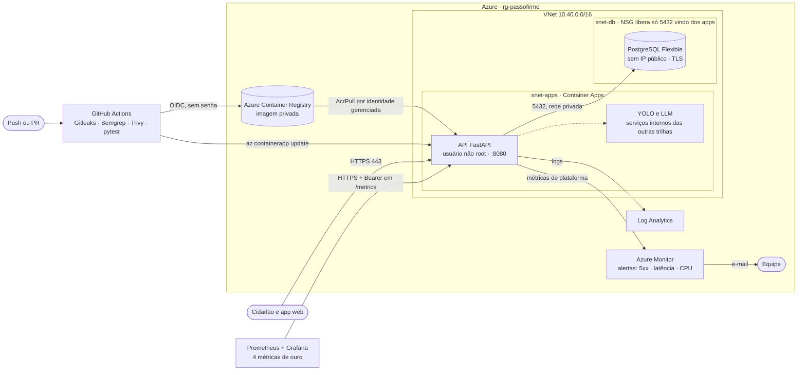

# Passo Firme

[](https://github.com/predowss/passo-firme/actions/workflows/devsecops.yml)

O Passo Firme mapeia, prioriza e encaminha barreiras nas calçadas de São Paulo, para que idosos e pessoas com deficiência caminhem sem cair. Este repositório tem a API do MVP e tudo o que a coloca no ar: container, infraestrutura como código na Azure, pipeline DevSecOps e observabilidade.

**MVP no ar:** https://ca-passofirme-api.lemonfield-b3da2f2c.brazilsouth.azurecontainerapps.io · [documentação da API](https://ca-passofirme-api.lemonfield-b3da2f2c.brazilsouth.azurecontainerapps.io/docs) · [saúde](https://ca-passofirme-api.lemonfield-b3da2f2c.brazilsouth.azurecontainerapps.io/health)

FIAP · Global Solution 2026.2 · CitizenTech · Engenharia de Software, 4º ano

## Integrantes

| Nome completo | RM | Trilha |
| --- | --- | --- |
| PREENCHER | RM00000 | Produto (app + API) |
| PREENCHER | RM00000 | DevOps e Cloud |
| PREENCHER | RM00000 | Visão Computacional + Maker Lab |
| PREENCHER | RM00000 | IA Generativa |
| PREENCHER | RM00000 | Big Data + RPA |

## Ficha Técnica do MVP

| Campo | Conteúdo |
| --- | --- |
| Nome do produto | Passo Firme |
| Cidadão e território | Idosos, pessoas com deficiência e pedestres que dependem de andar a pé, num distrito piloto de São Paulo (Jabaquara ou Itaquera). |
| Problema | Buracos, degraus e obstáculos nas calçadas derrubam e isolam justamente quem mais depende delas, e ninguém tem a visão do todo para priorizar o conserto. |
| Proposta de valor | Para o cidadão, de graça: fotografou, a IA identifica a barreira, explica quem é o responsável pela lei e encaminha. Para quem conserta: mapa priorizado por risco e população afetada, com prova em foto. |
| Arquitetura | App web acessível · API FastAPI + PostgreSQL · detector YOLO · assistente da lei (LLM local + RAG) · pipeline Airflow → Databricks · robô de triagem (RPA) · robô vistoriador (Maker Lab) · containers no Azure com Terraform e GitHub Actions. |
| Fontes de dados | SP156 (dados abertos da Prefeitura) · Open-Meteo · API do IBGE · relatos do app (foto + GPS) · leituras do robô · Lei 15.442/2011, Decreto 59.671/2020, Lei 13.146/2015 e Carta de Serviços do SP156. |
| Modelos de IA | YOLO (Ultralytics) treinado para barreiras de calçada · LLM aberto pequeno com RAG e LoRA · embeddings multilíngues · TinyML no robô. |
| URL e repositórios | MVP: https://ca-passofirme-api.lemonfield-b3da2f2c.brazilsouth.azurecontainerapps.io · Código: este repositório e os repositórios `passo-firme-*` da organização. |
| Indicadores de impacto | Barreiras mapeadas · % resolvidas · tempo médio até o conserto (antes e depois, pelo histórico do SP156) · idosos e pessoas com deficiência usando o app · metros de calçada vistoriados pelo robô. |
| ODS | 11 (metas 11.2 e 11.7) · 10 (meta 10.2) · 3 · 9 (meta 9.1) |

## Arquitetura de produção



Decisões, rede e identidades: [docs/arquitetura.md](docs/arquitetura.md).

## Rodar localmente

Requisitos: Docker com Compose v2. No Windows, use WSL ou Git Bash para os scripts.

```bash
./scripts/gerar-env-local.sh              # .env com senhas aleatórias (fora do Git)
docker compose up -d --build              # API + PostgreSQL
./scripts/smoke-test.sh http://localhost:8080
docker compose --profile obs up -d        # + Prometheus (9090) e Grafana (3000)
docker compose --profile ia up -d         # + LLM local (Ollama), opcional
```

A API fica em http://localhost:8080/docs. Testes: `cd api && pip install -r requirements-dev.txt && pytest`.

## Publicar na Azure

Requisitos: Azure CLI, Terraform 1.6 ou mais novo, GitHub CLI e uma assinatura Azure for Students.

```bash
LOCATION=eastus2 ./scripts/01-bootstrap-azure.sh   # state remoto + backend.hcl + terraform.tfvars
# edite infra/terraform.tfvars: github_repositorio e emails_alerta
cd infra
terraform init -backend-config=backend.hcl
terraform plan -out tfplan
terraform apply tfplan
cd ..
./scripts/02-configurar-github.sh                  # environment "producao", Secrets e Variables
git push origin main                               # o pipeline publica a API
```

Passo a passo completo, com os erros comuns da conta de estudante: [docs/passo-a-passo.md](docs/passo-a-passo.md).

## Pipeline DevSecOps

Arquivo: [.github/workflows/devsecops.yml](.github/workflows/devsecops.yml). Roda a cada push e pull request.

| Job | O que barra |
| --- | --- |
| Segredos (Gitleaks) | Chave, senha ou token em qualquer commit do histórico |
| SAST (Semgrep) | Falhas de segurança no código Python, no Dockerfile e segredos |
| IaC (Terraform + Trivy) | Terraform fora do padrão ou inválido e configuração insegura na nuvem |
| Testes (pytest) | Regressão no contrato da API |
| Build + Trivy (imagem) | Vulnerabilidade alta ou crítica com correção disponível na imagem |
| Deploy | Só na `main`, só se tudo acima passou: envia a imagem aprovada ao ACR, atualiza o Container App e confere em `/health` que a versão nova está no ar |

O login na Azure usa OIDC: o GitHub guarda só identificadores, nenhuma senha. O deploy só roda a partir da `main`, pelo environment `producao`.

## Observabilidade

- **Painel das 4 métricas de ouro** (latência, tráfego, erros e saturação) no Grafana, provisionado como código: [observabilidade/](observabilidade/). O Prometheus roda na máquina da equipe e coleta o `/metrics` do MVP publicado, protegido por token: `./scripts/configurar-prometheus.sh`.
- **Alertas** em dois lugares: regras do Prometheus ([alertas.yml](observabilidade/prometheus/alertas.yml)) e alertas do Azure Monitor com e-mail ([infra/monitoramento.tf](infra/monitoramento.tf)).
- **Disparar o alerta de propósito:** `./scripts/disparar-alerta.sh`.

## Segurança, LGPD e custo

- [Responsabilidade compartilhada](docs/responsabilidade-compartilhada.md)
- [Onde ficam os dados pessoais (LGPD)](docs/lgpd.md)
- [Estimativa de custo](docs/custo.md)
- [Roteiro de evidências para o PDF](docs/evidencias.md)

## Estrutura

```
api/                    API FastAPI, testes e Dockerfile
infra/                  Terraform (Azure)
.github/                pipeline DevSecOps e Dependabot
observabilidade/        Prometheus, regras de alerta e painel do Grafana
scripts/                bootstrap, configuração do GitHub, demos e testes
docs/                   arquitetura, responsabilidade compartilhada, LGPD, custo e evidências
docker-compose.yml      stack local (API, banco, LLM, Prometheus e Grafana)
```
